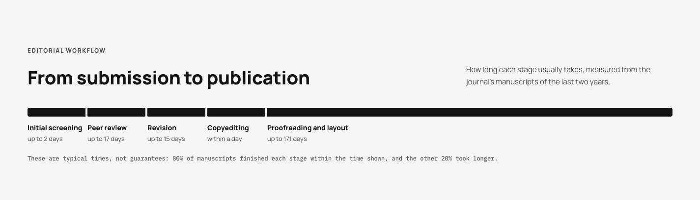
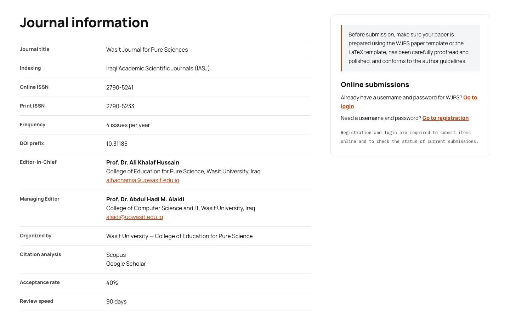
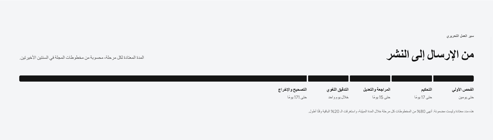
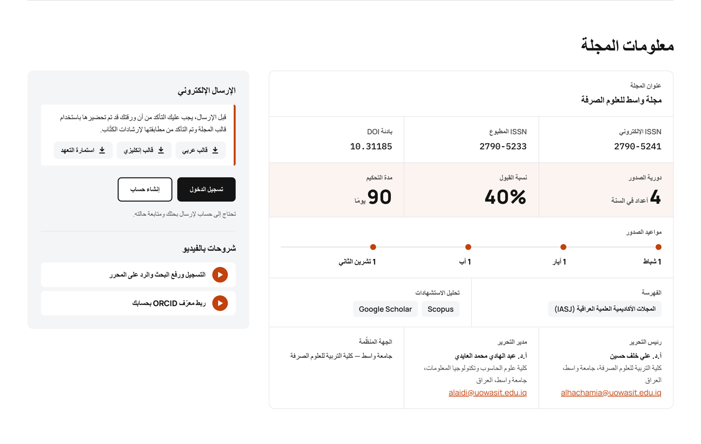

# Journal Pulse — OJS 3.5 theme

[English](#english) · [العربية](#arabic)

## English

A child theme of the default theme. Implements the "Journal in numbers" variant. Developed from [Journal Metrics](https://github.com/Radkevych/JournalMetrics) by Oleksandr Radkevych.

### Installation
1. Copy the `journalPulse` folder into `plugins/themes/` of your OJS so you get `plugins/themes/journalPulse/version.xml`.
2. Permissions: files must be readable by the web server (`chmod -R a+rX plugins/themes/journalPulse`).
3. Clear the template cache: Administration → Site → "Clear Template Cache" and "Clear Data Caches".
4. Settings → Website → Appearance → Theme → choose "Journal Pulse Theme" → Save.
5. On the same page, set the accent color, tagline, the open access model shown above the journal name (open, gold or diamond), and the "Usage metrics" and "Editorial workflow" toggles.

Upgrading from the theme's former name, `journalMetrics`: install `journalPulse` as above. Installing it copies the theme settings and switches the journals that used `journalMetrics` to it; then delete `plugins/themes/journalMetrics`.

### What it does
- Layout: wide container (up to 1560 px) with no sidebar; header: ISSN, language switcher, user menu (dropdown), journal title, "Submit a manuscript" button and the main menu in one row; on screens up to 992 px the menu becomes a burger. Skip links are invisible and appear only for keyboard users.
- Home page: a single H1 with the cover of the current issue under it (shown when the issue has a cover; it links to the issue), buttons, cards (views, PDF, articles, pages), an editorial workflow stage line with how long each stage usually takes (measured from the journal's own submissions) and a marker where the latest in-progress article currently is (stage only, no title or author), "Most read articles" (3 articles from the last two issues), a strip with the latest announcement, and the full list of articles in the current issue (title, authors, DOI, views, PDF).
- Article page: title → publication date → authors → DOI → PDF → abstract → keywords → author bio → references → "How to cite" and citation download; article details and usage are in a side card.
- Login, registration and password reset pages: the form sits on a white sheet over a grey background (full width on phones), with 48 px fields, a visible focus ring and the theme's buttons; the registration page shows its fields in pairs. Only the stylesheet changes these pages, not the OJS templates, so captcha, ORCID and plugins that add to these forms keep working.
- SEO: canonical for the home, issue and article pages (separately for each language); JSON-LD (Periodical on the home page, ScholarlyArticle on the article page); semantic markup; a single H1; hreflang and Google Scholar meta tags are left to OJS core and the Google Scholar plugin.

### Editorial workflow stages
The term under each stage is measured from the journal's own submissions of the last two years: the day of the stage by which 80% of the manuscripts had left it (the share OJS uses for its "days to first decision"). A stage starts with the editorial decision that moved the manuscript into it (screening starts at submission), and production ends at publication. The same numbers set the segment widths and are recalculated once a day. A stage with fewer than 5 finished manuscripts uses its default from `STAGE_DAYS` in `JournalPulseThemePlugin.php`. A note under the line says these are typical times, not guarantees. Stage names are in `locale/*/locale.po` (keys `plugins.themes.journalPulse.workflow.*`).

### Journal information
A "Journal information" section under the top of the home page lists the journal title, ISSN and DOI prefix (from the journal settings) and the fields filled in Settings → Website → Appearance → Theme: indexing, frequency, publication dates, Editor-in-Chief, Managing Editor, organizer, citation analysis, acceptance rate, review speed, a note shown above the login and registration buttons, files to download under that note (templates, forms), and video guides. Put each indexing service, publication date, file and video on its own line, and link each file's name and each video's title to it. Files can be hosted in Settings → Workflow → Publisher Library with Public Access turned on. Empty fields are not shown; untick "Journal information" to hide the section.

### Statistics
Views come from the OJS statistics service (`publicationStats`) and are cached for 1 hour. If statistics are disabled or empty, the metrics will be zero.

### For Google indexing (outside the theme)
Enable the Google Scholar plugin; make sure the journal is "enabled" (not noindex); submit https://example.com/index/sitemap in Search Console; check "Manual actions" and "Security issues".

License: GNU GPL v3.

## العربية

«نبض المجلة» قالب فرعي مبني على القالب الافتراضي (default). يطبّق نمط «المجلة بالأرقام». وهو مطوَّر عن [Journal Metrics](https://github.com/Radkevych/JournalMetrics) لـ Oleksandr Radkevych.

### التثبيت
1. انسخ مجلد `journalPulse` إلى `plugins/themes/` في نظام OJS لديك ليصبح المسار `plugins/themes/journalPulse/version.xml`.
2. الصلاحيات: يجب أن يتمكن خادم الويب من قراءة الملفات (`chmod -R a+rX plugins/themes/journalPulse`).
3. امسح ذاكرة التخزين المؤقت للقوالب: الإدارة ← الموقع (Administration) ← «Clear Template Cache» و«Clear Data Caches».
4. الإعدادات ← الموقع الإلكتروني ← المظهر (Appearance) ← القالب ← اختر «قالب نبض المجلة» ← حفظ.
5. في الصفحة نفسها، حدّد اللون المميّز والشعار ونموذج الوصول المفتوح الظاهر فوق اسم المجلة (مفتوح أو ذهبي أو ماسي) ومفتاحي «مؤشرات الاستخدام» و«سير العمل التحريري».

الترقية من الاسم السابق للقالب `journalMetrics`: ثبّت `journalPulse` كما سبق. ينسخ التثبيت إعدادات القالب وينقل المجلات التي كانت تستخدم `journalMetrics` إليه؛ ثم احذف `plugins/themes/journalMetrics`.

### ماذا يفعل
- الهيكل: حاوية عريضة (حتى 1560 px) بلا عمود جانبي؛ الترويسة: ISSN، ومبدّل اللغة، وقائمة المستخدم (منسدلة)، واسم المجلة، وزر «إرسال مخطوطة»، والقائمة الرئيسية في سطر واحد؛ على الشاشات حتى 992 px تتحول القائمة إلى زر همبرغر. روابط التخطي مخفية ولا تظهر إلا لمستخدمي لوحة المفاتيح.
- الصفحة الرئيسية: عنوان H1 واحد وتحته غلاف العدد الحالي (يظهر إذا كان للعدد غلاف، ويفتح العدد عند النقر عليه)، وأزرار، وبطاقات (المشاهدات، PDF، المقالات، الصفحات)، وخط مراحل سير العمل التحريري مع المدة المعتادة لكل مرحلة (محسوبة من مخطوطات المجلة نفسها) وإشارة إلى موضع آخر مقالة قيد العمل (المرحلة فقط، دون العنوان أو المؤلف)، و«المقالات الأكثر قراءة» (3 مقالات من آخر عددين)، وشريط بآخر إعلان، والقائمة الكاملة لمقالات العدد الحالي (العنوان، المؤلفون، DOI، المشاهدات، PDF).
- صفحة المقالة: العنوان ← تاريخ النشر ← المؤلفون ← DOI ← PDF ← الملخص ← الكلمات المفتاحية ← السيرة الذاتية للمؤلف ← قائمة المراجع ← «كيفية الاستشهاد» وتنزيل الاستشهاد؛ بيانات المقالة والاستخدام في بطاقة جانبية.
- صفحات الدخول والتسجيل وإعادة تعيين كلمة المرور: يظهر النموذج على ورقة بيضاء فوق خلفية رمادية (وبعرض الشاشة على الهاتف)، بحقول ارتفاعها 48 px وإطار تركيز واضح وأزرار القالب؛ وتُعرض حقول صفحة التسجيل في أزواج. تتغير هذه الصفحات عبر ملف الأنماط وحده دون استبدال قوالب OJS، فيبقى عمل الـ captcha وORCID والإضافات التي تضيف إلى هذه النماذج كما هو.
- تحسين محركات البحث (SEO): رابط canonical للصفحة الرئيسية والعدد والمقالة (لكل لغة على حدة)؛ JSON-LD (Periodical في الرئيسية، وScholarlyArticle في المقالة)؛ ترميز دلالي؛ عنوان H1 واحد؛ أما hreflang ووسوم Google Scholar الوصفية فتبقى من مسؤولية نواة OJS وإضافة Google Scholar.

### مراحل سير العمل التحريري
تُقاس المدة تحت كل مرحلة من مخطوطات المجلة نفسها في السنتين الأخيرتين: اليوم الذي كان 80% من المخطوطات قد غادر المرحلة بحلوله (وهي النسبة التي يعتمدها OJS في إحصائية «أيام حتى القرار الأول»). تبدأ المرحلة بالقرار التحريري الذي نقل المخطوطة إليها (ويبدأ الفحص الأولي بتاريخ التقديم)، وينتهي الإنتاج بالنشر. الأرقام نفسها تحدد عرض المقاطع، ويُعاد حسابها مرة كل يوم. المرحلة التي أنهتها أقل من 5 مخطوطات تستخدم قيمتها الافتراضية من `STAGE_DAYS` في `JournalPulseThemePlugin.php`. وتوضح ملاحظة تحت الخط أن هذه مدد معتادة وليست مضمونة. أسماء المراحل في `locale/*/locale.po` (المفاتيح `plugins.themes.journalPulse.workflow.*`).

### معلومات المجلة
يعرض قسم «معلومات المجلة» أعلى الصفحة الرئيسية عنوان المجلة ورقم ISSN وبادئة DOI (من إعدادات المجلة)، والحقول التي تُملأ في الإعدادات ← الموقع الإلكتروني ← المظهر ← القالب: الفهرسة، ودورية الصدور، ومواعيد النشر، ورئيس التحرير، ومدير التحرير، والجهة المنظِّمة، وتحليل الاستشهادات، ونسبة القبول، ومدة التحكيم، وملاحظة تظهر فوق زرّي الدخول والتسجيل، وملفات للتنزيل تحت تلك الملاحظة (قوالب، نماذج)، وأدلة الفيديو. ضع كل جهة فهرسة وكل موعد نشر وكل ملف وكل فيديو في سطر مستقل، واربط اسم كل ملف وعنوان كل فيديو به. يمكن استضافة الملفات في الإعدادات ← سير العمل ← مكتبة الناشر مع تفعيل «الوصول العام». الحقول الفارغة لا تظهر؛ ألغِ تحديد «معلومات المجلة» لإخفاء القسم.

### الإحصاءات
تُؤخذ المشاهدات من خدمة إحصاءات OJS (`publicationStats`) وتُخزَّن مؤقتًا لمدة ساعة واحدة. إذا كانت الإحصاءات معطّلة أو فارغة، فستظهر المؤشرات أصفارًا.

### للفهرسة في Google (خارج القالب)
فعّل إضافة Google Scholar؛ وتأكد من أن المجلة «مفعّلة» (وليست noindex)؛ وأرسل https://example.com/index/sitemap في Search Console؛ وتحقق من «الإجراءات اليدوية» و«مشكلات الأمان».

الترخيص: GNU GPL v3.

